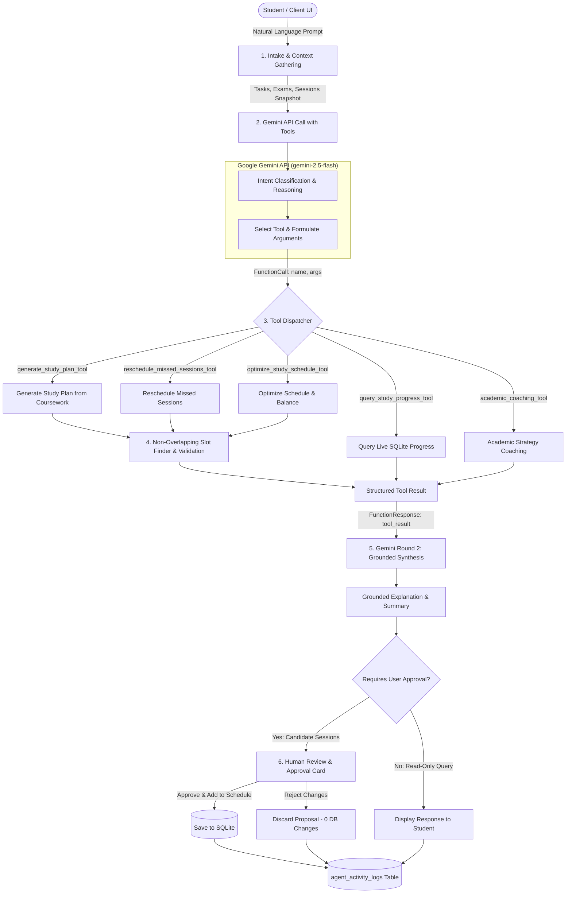

# AI Study Planner Agent — Full-Stack Autonomous Academic Planner (Phases 1, 2, 3 & 4)

An intelligent, student-centric academic planner powered by **React 19 + TypeScript + Tailwind CSS**, a **FastAPI + SQLite** backend with Alembic migrations, and an **Autonomous Google Gemini AI Agent** with genuine function calling, multi-round reasoning, real-time SQLite data execution, non-overlapping schedule synthesis, and human-in-the-loop safety approvals.

Styled with an editorial aesthetic: warm ivory background (`#FAF6F0`), soft borders (`#EFEAE1`), and muted gold accents (`#C5A059`).

---

## 🏗️ System Architecture & Gemini Function Calling Flow



### Directory Structure

```
Fundamentals of AI project/
├── frontend/                        # React 19 + Vite + TypeScript + Tailwind CSS
│   ├── src/
│   │   ├── components/              # Card, Button, Badge, Modal, Navigation
│   │   ├── context/                 # PlannerContext (connected to backend + LocalStorage fallback)
│   │   ├── pages/                   # Dashboard, Schedule, Tasks, AIAssistant
│   │   ├── services/                # Axios API layer (task, session, exam, dashboard, ai)
│   │   └── types/                   # Shared TypeScript models
│   ├── .env.example
│   └── package.json
│
├── backend/                         # FastAPI + SQLite + SQLAlchemy 2.x + Alembic
│   ├── app/
│   │   ├── api/v1/routes/           # Tasks, Sessions, Exams, Dashboard, AI / Agent routers
│   │   ├── core/                    # Config (Pydantic Settings), database session
│   │   ├── db/                      # SQLite engine, Alembic migrations, demo seeds
│   │   ├── models/                  # SQLAlchemy ORM models (User, Task, StudySession, Exam, AgentActivityLog)
│   │   ├── schemas/                 # Pydantic v2 schemas (tasks, sessions, exams, ai, agent)
│   │   ├── services/                # Business logic, overlap detection, Gemini & Agent service
│   │   │   ├── agent_service.py     # Genuine Gemini function calling loop & approval handlers
│   │   │   ├── agent_tools.py       # Pydantic schemas, SQLite tool execution, FunctionDeclarations
│   │   │   └── gemini_service.py    # Official google-genai client configuration
│   │   └── utils/                   # Date calculations, overlap interval algorithms
│   ├── alembic/                     # Migration scripts (including agent_activity_logs table)
│   ├── scripts/
│   │   └── verify_live_gemini.py    # Standalone live Gemini API verification script
│   ├── tests/                       # Pytest test suite (18 unit tests passed, live test skipped if no key)
│   ├── .env.example
│   ├── pytest.ini
│   └── requirements.txt
│
├── .gitignore
└── README.md
```

---

## ⚡ Quick Start

### 1. Configure the Real Gemini API

In `backend/.env`:
```env
APP_NAME=AI Study Planner Agent
ENVIRONMENT=development
DATABASE_URL=sqlite:///./study_planner.db
GEMINI_API_KEY=your_actual_gemini_api_key_here
GEMINI_MODEL=gemini-2.5-flash
FRONTEND_ORIGINS=http://localhost:5173
DEMO_USER_ID=demo-user-id
```

> **Security Note:** The API key is kept strictly on the backend. It is never transmitted to the frontend, never exposed in client bundles or logs, and never checked into Git.
> **Graceful Degradation:** If `GEMINI_API_KEY` is not yet configured, all core planner features (tasks, sessions, conflict prevention, schedule, dashboard, exams) continue to work with 100% reliability, and the AI Assistant returns a clear, helpful notification.

### 2. Start the Backend (FastAPI)

```powershell
cd backend
python -m venv .venv
.\.venv\Scripts\activate
pip install -r requirements.txt
alembic upgrade head
uvicorn app.main:app --reload --port 8000
```

- API Base: `http://localhost:8000/api/v1`
- Swagger UI Documentation: `http://localhost:8000/docs`
- Health check: `http://localhost:8000/health`
- Agent endpoints:
  - `POST /api/v1/ai/agent/execute` — Genuine Gemini tool calling & execution
  - `POST /api/v1/ai/schedule/approve` — Human-in-the-loop proposal approval
  - `POST /api/v1/ai/schedule/reject` — Proposal rejection (leaves DB untouched)
  - `GET /api/v1/ai/logs` — Agent activity audit logs

### 3. Start the Frontend (React + Vite)

In a separate terminal:

```powershell
cd frontend
npm install
npm run dev
```

- Web Application: `http://localhost:5173/`

---

## 🛠️ The 5 Specialized Agent Tools

The real Gemini model is equipped with 5 tools declared via `types.FunctionDeclaration` in [`agent_tools.py`](file:///c:/Users/ADITYA/OneDrive/Documents/Fundamentals%20of%20AI%20project/backend/app/services/agent_tools.py):

| Tool Name | Responsibility | Database Queries | Requires Approval? |
|---|---|---|---|
| `generate_study_plan_tool` | Generates personalized study plan targeting specific goals or exams | Pending tasks & upcoming exams from SQLite; calculates non-conflicting time slots | **Yes** (`requires_approval: true`) |
| `query_study_progress_tool` | Computes live academic metrics, completion rates, study hours, and streaks | SQLite tasks & exams; live completion statistics | **No** (Direct response) |
| `reschedule_missed_sessions_tool` | Finds missed sessions and allocates makeup slots on upcoming days | Queries `StudySession` (`status == "missed"`); computes non-overlapping slots | **Yes** (`requires_approval: true`) |
| `optimize_study_schedule_tool` | Balances workload and prevents cognitive burnout | Analyzes existing commitments and schedules priority blocks | **Yes** (`requires_approval: true`) |
| `academic_coaching_tool` | Provides cognitive and study advice grounded in student courses | Active courses & exam timetable | **No** (Direct response) |

---

## 🧪 Automated Testing & Verification

### 1. Backend Unit Tests (Pytest with Mocked Gemini)
All unit tests run reliably offline and in CI without requiring an active API key or incurring costs:
```powershell
cd backend
.\.venv\Scripts\pytest.exe -v
```
**Results:** **18 passed, 1 skipped** in ~0.6s:
- `test_agent_missing_key_returns_503` PASSED
- `test_agent_workflow_generates_plan_with_steps` PASSED
- `test_agent_progress_query` PASSED
- `test_agent_reschedule_missed_sessions` PASSED
- `test_agent_optimize_schedule` PASSED
- `test_agent_academic_coaching_direct` PASSED
- `test_safe_schedule_approval_persists_data` PASSED
- `test_safe_schedule_rejection_leaves_database_unmodified` PASSED
- `test_agent_activity_logs` PASSED
- `test_ai_missing_key_returns_503` PASSED
- `test_ai_generate_plan_mocked_success` PASSED
- `test_ai_ask_mocked_success` PASSED
- `test_ai_malformed_json_returns_502` PASSED
- `test_dashboard_calculations` PASSED
- `test_exams.py::test_exam_lifecycle` PASSED
- `test_health.py::test_health_check` PASSED
- `test_sessions.py::test_session_lifecycle_and_overlap_rules` PASSED
- `test_tasks.py::test_create_and_get_tasks` PASSED
- `test_live_gemini.py` SKIPPED (run when key is provided)

### 2. Live Gemini Verification Script
When you have added your real `GEMINI_API_KEY` to `backend/.env`, run the isolated verification script:
```powershell
cd backend
python scripts/verify_live_gemini.py
```
This script tests:
1. Genuine Gemini intent classification and tool selection.
2. Real SQLite execution against an isolated in-memory test database.
3. Gemini round 2 grounded response synthesis.
4. Schedule approval persistence and conflict avoidance.
5. Rejection database isolation.
6. SQLite audit log entry creation.

### 3. Frontend TypeScript & Production Build
```powershell
cd frontend
npm run build
```
**Results:** **0 errors**, production bundle compiled cleanly in `<1.5s`.

---

## 🛡️ Safety & Reliability Principles
- **No Direct SQL Execution:** Gemini is never permitted to execute raw SQL or access the filesystem; tools run through validated Python handlers with Pydantic schemas.
- **Strict Non-Overlapping Scheduling:** Interval math (`s1 < e2 && e1 > s2`) guarantees sessions cannot double-book time slots.
- **Human-in-the-Loop Approval:** Schedule modifications are candidate proposals only until the student clicks **Approve & Add to Schedule**.
- **Full Traceability:** Every tool invocation, argument set, and approval/rejection decision is logged in `agent_activity_logs`.
